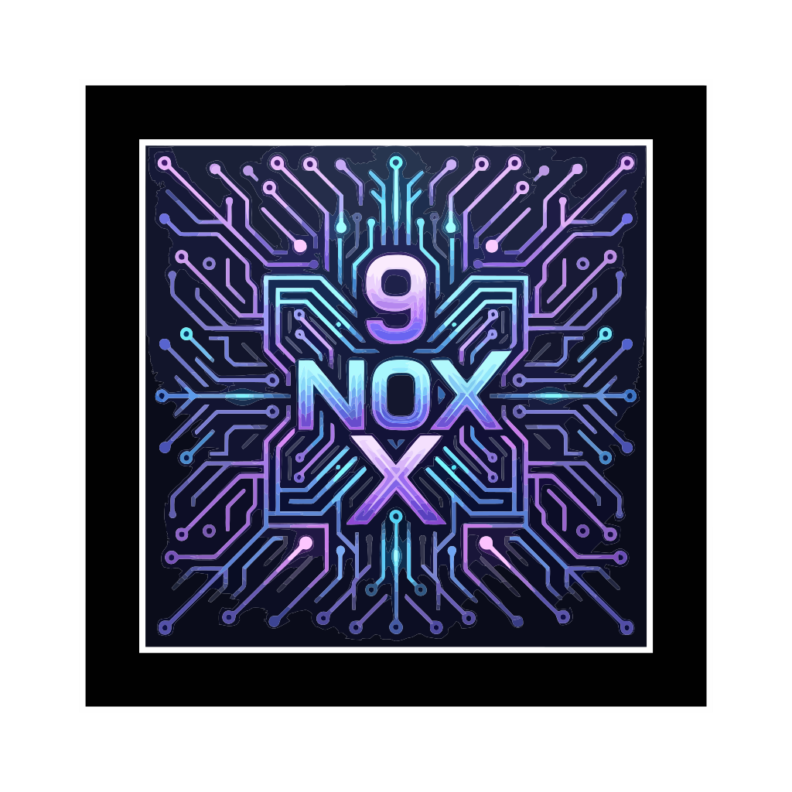
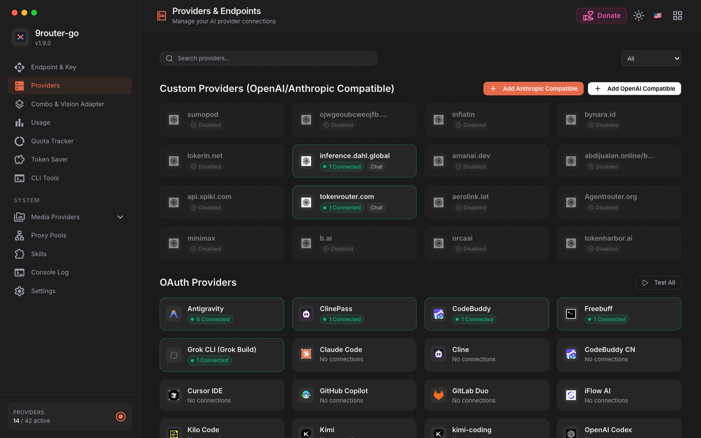
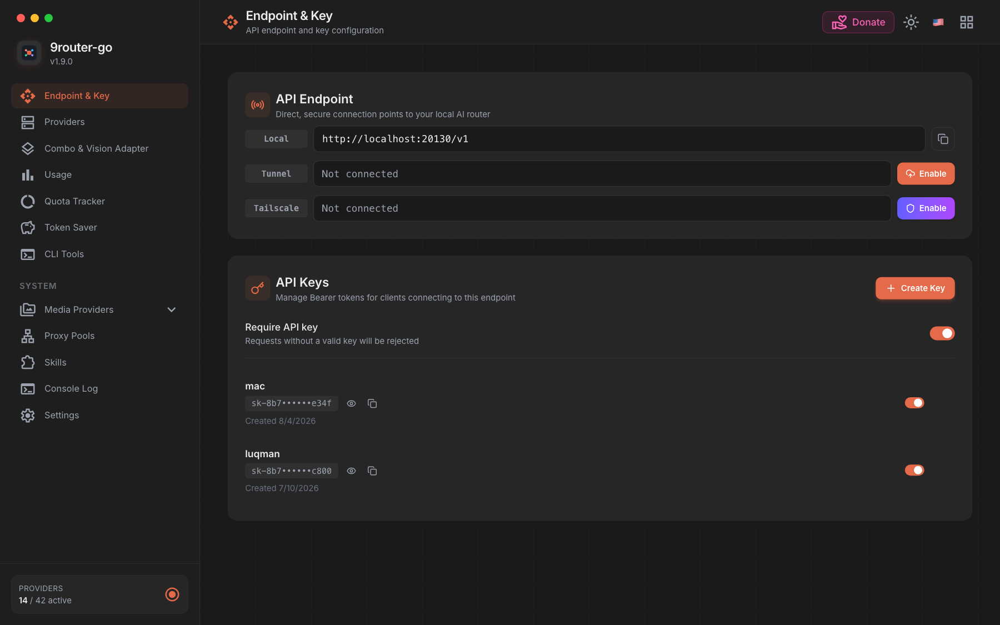

<p align="center">
  
</p>

<div align="center">

# NOX9GO — FREE AI GATEWAY

**Never stop coding. Save 20-40% tokens with RTK + auto-fallback to FREE & cheap AI models.**

**Connect Claude Code, Codex, Cursor, Antigravity, Gemini, OpenCode, Cline, OpenClaw... to 140+ AI providers & 800+ models — one Go binary, no Node.js needed at runtime.**

Personal fork · version **1.0.0** · private use

[🚀 Quick Start](#-quick-start) • [🌐 Providers](#-supported-providers) • [💡 Features](#-key-features) • [❓ FAQ](#-frequently-asked-questions) • [📖 Setup](#-setup-guide) • [🔄 Share DB with 9Router](#-sharing-a-database-with-9router) • [🌐 Upstream](https://github.com/decolua/9router)

</div>

---

## 🚀 What NOX9GO adds over upstream 9Router

NOX9GO is a **native Go rewrite** of [9Router](https://github.com/decolua/9router). It keeps the same
wire contract and the same SQLite database, and replaces the Node.js runtime with a static binary:

- 🧱 **One static binary** — the proxy, the API surface and the dashboard ship as a single Go executable. No
  Node.js, no Bun, no `node_modules` on the target machine.
- 🖥️ **Native Svelte 5 dashboard** — compiled to a static bundle and embedded in the binary
  (`web/embed.go`), served pre-compressed (`.br`/`.gz`) from the gateway's own origin.
- 📦 **Cross-compile ready** — `linux-amd64`, `linux-arm64`, `darwin-amd64`, `darwin-arm64`,
  `windows-amd64` with `CGO_ENABLED=0` (local packaging; this fork does not publish releases).
- 🛠️ **First-class autostart** — `service install` picks the native backend: systemd, launchd, OpenRC, runit,
  cron, or a Windows scheduled task.
- 🪶 **Token savers beyond RTK** — RTK (on by default), Caveman, Ponytail, an action-first "ADHD" prompt
  style, and a **prompt-injection guard** that is on unless you disable it.
- 🔀 **Combos with real strategies** — fallback, round-robin, sticky, capacity, and fusion, plus
  capability-aware reordering.
- 🔌 **Proxy pools per connection** — bind a pool to a single API key or apply one across many at once.
- 📊 **Observability that upstream does not ship** — live console-log SSE with level filters and search, a
  per-request payload inspector, stall detection, and compression/cache analytics.
- 🎨 **Media & search providers** — image generation, TTS, STT, video, embeddings, web search and page fetch
  all route through the same gateway and the same API keys.
- 🗄️ **Same database as upstream 9Router** — point both at the same `DATA_DIR` and they share providers,
  combos, keys and usage history. No import, no migration.

---

## 🤔 Why NOX9GO?

Same idea as [9Router](https://github.com/decolua/9router), minus the Node.js runtime: **one Go binary**
serves the proxy APIs + an embedded Svelte dashboard.

**Stop wasting money, tokens and hitting limits:**

- ❌ Subscription quota expires unused every month
- ❌ Rate limits stop you mid-coding
- ❌ Tool outputs (git diff, grep, ls...) burn tokens fast
- ❌ Manual switching between providers

**NOX9GO solves this:**

- ✅ **RTK Token Saver** — auto-compress tool_result content, save 20-40% tokens
- ✅ **Auto fallback** — Subscription → Cheap → Free, zero downtime
- ✅ **Extended combo routing** — per-combo strategy: fallback, round-robin, sticky, capacity, or fusion
- ✅ **Multi-account** — round-robin between accounts per provider
- ✅ **Proxy per API key** — bind a proxy pool to each provider API key (connection), one-by-one or via **Apply Proxy** across many at once
- ✅ **Custom headers** — add your own request headers to custom compatible providers
- ✅ **Unified custom provider add** — one shared dialog adds OpenAI-/Anthropic-compatible endpoints
- ✅ **Custom usage ranges** — analyze any window (`14d`, `12h`), not just fixed presets
- ✅ **Extended logging** — live console log with level filters & search, plus per-request payload inspector
- ✅ **Single binary** — Go + embedded dashboard, works with Claude Code, Codex, Cursor, Cline, any CLI tool

---

## 🔄 How It Works

```text
┌─────────────┐
│  Your CLI   │  (Claude Code, Codex, OpenClaw, Cursor, Cline...)
│   Tool      │
└──────┬──────┘
       │ http://localhost:20130/v1
       ↓
┌─────────────────────────────────────────────┐
│         NOX9GO (Smart Router)              │
│  • RTK Token Saver (cut tool_result tokens) │
│  • Format translation (OpenAI ↔ Claude)     │
│  • Quota tracking                           │
│  • Auto token refresh                       │
└──────┬──────────────────────────────────────┘
       │
       ├─→ [Tier 1: SUBSCRIPTION] Claude Code, Codex, GitHub Copilot
       │   ↓ quota exhausted
       ├─→ [Tier 2: CHEAP] GLM ($0.6/1M), MiniMax ($0.2/1M)
       │   ↓ budget limit
       └─→ [Tier 3: FREE] Kiro, OpenCode Free, Vertex ($300 credits)

Result: Never stop coding, minimal cost + 20-40% token savings via RTK
```

---

## ⚡ Quick Start

This is a **private personal fork**. There is no public one-line installer or GitHub Release
channel. Build from the clone you already have:

```bash
# From the repo root (needs Go 1.27 + Bun 1.x for the dashboard)
make web-build
make build          # writes ./nox9go (or nox9go.exe on Windows)
./nox9go start      # or: .\nox9go.exe start
# Dashboard: http://localhost:20130 (Default password: 123456)
```

On Windows you can also use the desktop launcher / tray (`make tray`, then
`scripts/start-nox9go.ps1`) so the gateway starts without a flashing Terminal.

> **Already using upstream [9Router](https://github.com/decolua/9router)?** Point NOX9GO at the same
> data dir — it opens the **same `DATA_DIR/db/data.sqlite`**. Your providers, connections, combos, API keys,
> and usage history carry over as-is. No import step, no migration. See
> [Sharing a database with 9Router](#-sharing-a-database-with-9router) for the caveats.

<details>
<summary><b>📦 Cross-compile (optional)</b></summary>

`make cross` (or the `CROSS_TARGETS` loop in the Makefile) builds the five release
targets with `CGO_ENABLED=0`. That is for local packaging only — this private repo
does not publish GitHub Releases.

</details>

### CLI reference

| Command | What it does |
| --- | --- |
| `nox9go` | Run the gateway in the foreground (default port `20130`, data `~/.nox9go`) |
| `nox9go start` | Run detached in the background (same as `nox9go --background`, or `-d`) |
| `nox9go stop` | Stop the background daemon |
| `nox9go restart` | Replace the running daemon |
| `nox9go status` | Is it running? (pid, dashboard, log) |
| `nox9go logs -n 100` | Tail the background log (`-n` = number of lines) |
| `nox9go service install` | Register an autostart entry (systemd, launchd, OpenRC, runit, cron, Windows task) |
| `nox9go service status` | Which backend owns the entry, and whether it is enabled/active |
| `nox9go service start\|stop\|restart` | Control the supervised service (falls back to the background daemon) |
| `nox9go service uninstall` | Remove the autostart entry |
| `nox9go version` | Print version, OS/arch, and the update check result |
| `nox9go update` | Download and install the latest stable release |
| `nox9go mitm enable\|disable\|status` | Toggle the MITM proxy commands |

Global flags:

| Flag | Default | Purpose |
| --- | --- | --- |
| `--rtk` | `true` | RTK input compression (env: `RTK_ENABLED`) |
| `--caveman` | `false` | Caveman terse output style (env: `CAVEMAN_ENABLED`) |
| `--ponytail` | `false` | Ponytail lazy-dev code style (env: `PONYTAIL_ENABLED`) |
| `--adhd` | `false` | Action-first "I have ADHD" prompt style (env: `ADHD_ENABLED`) |
| `--auto-update` | `false` | Download and install updates in the background (env: `AUTO_UPDATE`) |
| `--no-injection-guard` | `false` | Disable the prompt-injection detector (env: `INJECTION_GUARD_DISABLED`) |
| `-d`, `--background` | `false` | Detach from the terminal and return |

> There are no `--port` / `--data-dir` flags: the runtime is configured through environment variables
> (`PORT`, `HOST`, `DATA_DIR`, `DB_PATH`). See [Environment](#environment).

**Keep the terminal free (background mode):**

```bash
nox9go start          # same as: nox9go --background   (or -d)
nox9go status         # is it running? (pid, dashboard, log)
nox9go restart        # replace the running daemon
nox9go logs -n 100    # tail the background log
nox9go stop           # stop it
```

The detached process records itself in `DATA_DIR/run/gateway.pid` and writes its
output to `DATA_DIR/run/gateway.log`. A second `start` while one is running
refuses instead of fighting over the port, and a daemon killed from Task Manager
leaves nothing behind: the stale pid file is cleaned on the next command.
> Windows stops the process with `TerminateProcess` instead of `SIGTERM`, so
> stopping skips the graceful drain; use the dashboard's Shutdown button or
> `nox9go restart` when you want in-flight streams to finish first.

**Start on boot (autostart):**

```bash
nox9go service install     # systemd user unit, launchd agent, OpenRC/runit service, cron @reboot, or a Windows logon task
nox9go service status      # which backend owns the entry, and whether it is enabled/active
nox9go service start       # start the supervised service now (falls back to the background daemon)
nox9go service restart     # restart it
nox9go service stop        # stop it now but keep it enabled for boot
nox9go service uninstall   # remove the autostart entry
```

`install` picks the native backend for the host. systemd, launchd, and cron all
install into the **user** scope and need no root; runit's `~/service` path too.
Two exceptions: OpenRC is a system service and needs root (`service install`
refuses without it — run with `sudo`, or pick `--backend cron`), and on Windows
install registers a scheduled task via `schtasks`, which requires an
Administrator console. The Windows task runs as the current user at logon, so it
reads that user's data dir rather than `SYSTEM`'s. Force a backend with
`--backend systemd|launchd|openrc|runit|cron`.

**2. Connect a FREE provider (no signup needed):**

Dashboard → Providers → Connect **Kiro AI** (~50 credits/month free) or **OpenCode Free** (no auth) → Done!

**3. Use in your CLI tool:**

```text
Claude Code / Codex / OpenClaw / Cursor / Cline Settings:
  Endpoint: http://localhost:20130/v1
  API Key:  [Settings → API Keys in the dashboard]
  Model:    kr/claude-sonnet-4.5
```

**That's it!** Start coding with FREE AI models.

---

## 🛠️ Supported CLI Tools

The dashboard ships a setup guide for **24 AI tools and IDEs**, and detects 16 of them on the machine
(binary on `PATH`, plus a config-directory check for the ones that have no binary) so the panel can show
what is installed and which version. Each card tells you exactly what to apply: an environment variable, a
settings-file change, or a step-by-step guide.

| Tool | Tool | Tool |
| --- | --- | --- |
| Claude Code | Cursor IDE | Cline |
| Antigravity | Kiro AI | OpenAI Codex |
| GitHub Copilot | Factory Droid | Devin CLI |
| Hermes | OpenClaw | Kilo Code |
| Grok Build | OpenCode | Cowork |
| RooCode | Continue | Amp |
| Qwen Code | DeepSeek TUI | jcode |
| opendesign | pi | omp |

**Claude Code** is the shortest path — two environment variables:

```bash
export ANTHROPIC_BASE_URL="http://localhost:20130"
export ANTHROPIC_API_KEY="<your-api-key>"
```

**Cursor** points at the OpenAI-compatible base URL instead: *Settings → Models → Override OpenAI Base
URL* → `http://localhost:20130/v1`, with your gateway API key in the *OpenAI API Key* field.

The same list, with the live detection state, lives in the dashboard under **CLI Tools**.

---

## 🌐 Supported Providers

The gateway knows **142 registered providers** (`internal/providers/providers.go`) and the dashboard groups
them into the categories below. Model ids use the `<prefix>/<model>` form, so `ag/gemini-3.8-flash-high`
means "the Antigravity provider, the `gemini-3.8-flash-high` model". The prefix below is the one
`GET /v1/models` returns; the short aliases the dashboard shows (`or` for OpenRouter, `tg` for Together,
`ant` for Anthropic, ...) resolve to the same provider.

### 🔐 OAuth & subscription providers

Sign in with the provider's own browser flow — no API key to paste.

| Prefix | Provider | Prefix | Provider |
| --- | --- | --- | --- |
| `ag` | Antigravity | `cc` | Claude Code |
| `cl` | Cline | `clinepass` | ClinePass |
| `cbai` | CodeBuddy (Intl) | `cbcn` | CodeBuddy CN |
| `cu` | Cursor IDE | `gh` | GitHub Copilot |
| `gitlab` | GitLab Duo | `gcli` | Grok CLI (Grok Build) |
| `if` | iFlow AI | `kc` | Kilo Code |
| `kimi` | Kimi | `kimi-coding` | kimi-coding |
| `muse` | Muse (Meta Model API) | `cx` | OpenAI Codex |
| `qdcn` | Qoder CN | `qd` | Qoder |
| `xai` | xAI (Grok) | `mimo` | Xiaomi MiMo |
| `zd` | Zed | `freebuff` | Freebuff |
| `mmc` | MiniMax Code | `mmg` | MiniMax Code (Global) |
| `trae` | trae | `windsurf` | windsurf |

### 🆓 Free & no-signup providers

No account, no key, no credit card.

| Prefix | Provider | What you get |
| --- | --- | --- |
| `oc` | OpenCode Free | The OpenCode free model pool, no auth at all |
| `kr` | Kiro AI | ~50 free credits/month |
| `gc` | Gemini CLI | Gemini CLI OAuth, free tier |
| `mmf` | MiMo Code Free | Free coding pool |
| `devin-cli` | Devin CLI | Free allowance from a Devin subscription |

### 🆓 Providers with a free tier

Sign-up gives you a key and a free allowance; the gateway treats them as API-key providers.

`agnes` Agnes AI · `af` API.airforce · `bzl` Bazaarlink · `bpm` BytePlus ModelArk · `cf` Cloudflare ·
`dx` DaoXE · `coqui` Coqui TTS · `edge-tts` Edge TTS · `gemini` Gemini · `google-tts` Google TTS ·
`kgw` Kilo Gateway · `nan` NaN.Builders · `oad` OpenAdapter · `kimchi` Kimchi · `local-device` Local Device ·
`nous` Nous Research · `nvidia` NVIDIA NIM · `ollama` Ollama Cloud · `openrouter` OpenRouter ·
`ps` Poolside · `searxng` SearXNG · `tortoise` Tortoise TTS · `vx` Vertex AI

### 🌐 Web-session providers

These authenticate with a browser cookie instead of a key. The dashboard handles the capture.

| Prefix | Provider | Note |
| --- | --- | --- |
| `gweb` | Gemini Web | Session cookie; the router renews it in the background (see below) |
| `gw` | Grok Web | Subscription session |
| `pw` | Perplexity Web | Pro/Max session |
| `ds-web` | DeepSeek Web | Web session |

### 🔑 API key providers

88 providers, grouped by what they serve. Full list lives in
[`web/src/lib/providers.ts`](web/src/lib/providers.ts).

**LLM APIs and aggregators**

`openai` OpenAI · `anthropic` Anthropic · `ds` DeepSeek · `groq` Groq · `mistral` Mistral ·
`together` Together AI · `fireworks` Fireworks AI · `cerebras` Cerebras · `ch` Chutes AI ·
`siliconflow` SiliconFlow · `nebius` Nebius AI · `samba` SambaNova · `hyp` Hyperbolic ·
`fl` Featherless · `openrouter` OpenRouter · `ocz` OpenCode Zen · `ocg` OpenCode Go ·
`bb` Blackbox AI · `vercel` Vercel AI Gateway · `v1m` v1m (System One) · `morph` Morph ·
`llm7` LLM7 · `tokenharbor` Token Harbor · `sp` SumoPod · `dahl` Dahl Inference · `bai` B.AI ·
`atria` Atria Dawn · `tinyfish` TinyFish · `tokenrouter` TokenRouter · `xquik` Xquik ·
`pa` Perplexity Agent · `pplx` Perplexity · `cohere` Cohere · `mmf` MMF · `cmc` Command Code ·
`bm` Bluesminds

**China / Asia providers**

`alicode` Alibaba · `alicode-intl` Alibaba Coding · `alims-intl` Alibaba Studio ·
`alitp-intl` Alibaba Token Plan · `glm` GLM Coding · `glm-cn` GLM (China) · `qianfan` Baidu Qianfan ·
`ark` Volcengine Ark · `hunyuan` Tencent Hunyuan · `minimax` Minimax Coding · `minimax-cn` Minimax (China) ·
`bpm` BytePlus

**Cloud platforms**

`azure` Azure OpenAI · `br` AWS Bedrock · `brx` AWS Bedrock (xAI) · `gpse` Google PSE ·
`vxp` Vertex Partner

**Image, video and voice**

`bfl` Black Forest Labs · `stability` Stability AI · `nb` NanoBanana API · `recraft` Recraft ·
`runway` Runway ML · `fal` Fal.ai · `topaz` Topaz · `el` ElevenLabs · `dg` Deepgram ·
`aai` AssemblyAI · `fish` Fish Audio · `polly` AWS Polly · `playht` PlayHT · `cartesia` Cartesia ·
`inworld` Inworld TTS · `xmtp` Xiaomi MiMo (Token Plan)

**Search, fetch and embeddings**

`brave` Brave Search · `tavily` Tavily · `serper` Serper · `searchapi` SearchAPI · `exa` Exa ·
`linkup` Linkup · `youcom` You.com Search · `jina` Jina AI · `jina-reader` Jina Reader ·
`firecrawl` Firecrawl · `zai-search` Z.ai Web Search · `voyage` Voyage AI

**Local and self-hosted**

`ollama-local` Ollama Local · `comfyui` ComfyUI · `sdwebui` SD WebUI · `ollama-search` Ollama Search ·
`selfhosted-tts` Self-Hosted TTS · `selfhosted-stt` Self-Hosted STT ·
`selfhosted-embedding` Self-Hosted Embedding

**Custom OpenAI-/Anthropic-compatible endpoints** are not a fixed list: the dashboard's unified *Add
provider* dialog accepts any compatible base URL, and the gateway stores the auth header and static headers
per connection.

---

## 💡 Key Features

| Feature | What it does | Why it matters |
| --- | --- | --- |
| 🪶 **RTK Token Saver** | Compresses tool outputs (`git diff`, `grep`, `ls`, `tree`...) before sending to the LLM | Save **20-40% input tokens** per request |
| 🗣️ **Caveman** | Injects a caveman-speak prompt → the LLM replies terse, technical substance preserved | Save **up to 65% output tokens** |
| 🐴 **Ponytail** | Injects a "lazy senior dev" prompt → the LLM writes minimal, YAGNI-first code | Fewer output tokens, less refactoring |
| 🧠 **ADHD prompt style** | Action-first prompt style for LLMs that drift into long prose | Less noise per answer |
| 🛡️ **Injection guard** | Detects prompt-injection attempts in tool output before they reach the model | **On by default**, toggle in settings |
| 🔀 **Format translation** | OpenAI ↔ Claude Messages ↔ Gemini ↔ Cursor ↔ Kiro ↔ Vertex ↔ Ollama | Works with any CLI tool |
| 🧱 **Combos** | Per-combo strategy: fallback, round-robin, sticky, capacity, fusion | One endpoint, many upstreams, no downtime |
| 👥 **Multi-account** | Round-robin between accounts of the same provider | Spread quota across accounts you own |
| 📊 **Quota tracking** | Live quota per connection, strike-breaker handling | Know what is left before it fails |
| 🔑 **Proxy pools** | Bind a proxy pool to a connection, or apply one across many | Route provider traffic through your own egress |
| 📝 **Request logging** | Live console-log SSE with level filters and search, plus a per-request payload inspector | See exactly what went upstream |
| 📈 **Usage analytics** | Tokens, cost, trends, per-model and per-cache/compression breakdowns | Optimize spending |
| 🎨 **Media & search** | Image, TTS, STT, video, embeddings, web search, page fetch | One gateway for every modality |
| 🌍 **Deploy anywhere** | Localhost, VPS, systemd/launchd/OpenRC/runit/cron, Windows task | Runs on a 1 vCPU box |

Every saver is a global switch: toggle it in the dashboard, with the matching CLI flag (`--rtk`, `--caveman`,
`--ponytail`, `--adhd`, `--no-injection-guard`), or with the matching environment variable.

<details>
<summary><b>📖 Feature details</b></summary>

### 🪶 RTK Token Saver

Tool outputs (`git diff`, `grep`, `find`, `ls`, `tree`, log dumps...) often eat 30-50% of your prompt budget.
RTK detects them and applies smart, lossless compression **before** the request hits the LLM:

- **Filters:** `git-diff`, `git-status`, `grep`, `find`, `ls`, `tree`, `dedup-log`, `smart-truncate`,
  `read-numbered`, `search-list`
- **Auto-detect:** no config needed — RTK peeks at each `tool_result` and picks the right filter.
- **Safe by design:** if a filter fails, throws, or makes the output bigger, the original text is kept. Errors
  never break your request.
- **Universal:** it runs **before** any format translation, so it works across every protocol.
- **Default ON** (toggle with `--rtk` / `RTK_ENABLED`).

```
Without RTK:  47K tokens sent to LLM
With RTK:     28K tokens sent to LLM   (40% saved · same context · same answer)
```

### 🗣️ Caveman & 🐴 Ponytail & 🧠 ADHD

Three prompt-level savers, all off by default, all toggleable from the dashboard:

- **Caveman** rewrites the system prompt into caveman-speak: the model stops explaining and starts shipping.
- **Ponytail** injects the "lazy senior dev" ladder: minimum code, no speculative abstraction, YAGNI first.
- **ADHD** asks for action-first output: the answer starts with the next action, not with the preamble.

### 🔀 Combos

A combo is a named list of models with a routing strategy:

| Strategy | Behaviour |
| --- | --- |
| `fallback` | Walk the list in order until one provider succeeds (the default) |
| `round-robin` | Distribute requests across the list |
| `sticky` | Pin a client to one entry for a while |
| `capacity` | Route to whichever entry has the most remaining capacity |
| `fusion` | Merge answers from several entries into one response |

Combos reordering is capability-aware: an entry that cannot serve the request's modality is skipped before it
is tried.

### 👥 Multi-account & 🔑 Proxy pools

- **Multi-account** rotates between the accounts of one provider — useful when a subscription splits its quota
  across seats.
- **Proxy pools** hold a list of upstream proxies with a `round-robin` (default) or `random` strategy. Bind one
  to a single connection, or use **Apply Proxy** to point many connections at the same pool.

### 📊 Quota, logging and analytics

- **Quota tracking** reads each provider's quota endpoint and shows the remaining allowance per connection.
  When a provider starts failing, the strike-breaker moves the request to the next entry instead of retrying
  into the same wall.
- **Console log** is a live SSE stream: level filters, text search, and a per-request payload inspector that
  shows the exact request and response.
- **Usage analytics** breaks usage down by model, provider, day, and cost, with separate views for cache
  hits and token-compression savings.

### 🎨 Media, voice and search

Beyond chat, the gateway routes image generation (`/v1/images/generations`), video
(`/v1/videos/generations`), text-to-speech (`/v1/audio/speech`), speech-to-text
(`/v1/audio/transcriptions`), embeddings (`/v1/embeddings`) and web search (`/v1/search`) — with the same
API keys, the same combos, and the same usage accounting as chat.

### 🌍 Deploy anywhere

The binary is self-contained, so the deployment surface is: run it directly, or install it as a user service
(systemd/launchd/OpenRC/runit/cron/Windows task). The database is one SQLite file — point `DATA_DIR` wherever
the box keeps its state.

</details>

---

## 💰 Pricing at a Glance

NOX9GO never charges you anything. It is free, open-source software that runs on your own machine. The
table below is what the **providers** cost — the router only moves the traffic.

| Tier | Provider | Typical cost | Limit | Who it is for |
| --- | --- | --- | --- | --- |
| 💰 **Subscription** | Claude Code (`cc/`) | $20-200/mo | 5h + weekly | Anthropic users with a Pro/Max seat |
| 💰 **Subscription** | OpenAI Codex (`cx/`) | $20-200/mo | 5h + weekly | OpenAI users |
| 💰 **Subscription** | GitHub Copilot (`gh/`) | $10-19/mo | Monthly | Copilot subscribers |
| 💰 **Subscription** | Cursor IDE (`cu/`) | $20-20/mo | Monthly | Cursor users |
| 💰 **Subscription** | Grok CLI (`gcli/`), windsurf, trae, Zed, Kimi Coding | varies | Varies | Subscription users |
| 💵 **Cheap API** | GLM (`glm/`) | ~$0.6/1M | — | Cheapest paid coding models |
| 💵 **Cheap API** | MiniMax (`mmc/`, `minimax/`) | ~$0.2/1M | 5-hour rolling | Cheapest option in the catalogue |
| 💵 **Cheap API** | DeepSeek (`ds/`) | ~$0.3/1M | — | Cheap general reasoning |
| 🆓 **Free** | Kiro AI (`kr/`) | $0 | ~50 credits/mo | Claude 4.5 + GLM-5 + MiniMax free |
| 🆓 **Free** | OpenCode Free (`oc/`) | $0 | Free pool | Zero-cost coding |
| 🆓 **Free** | Gemini CLI (`gc/`) | $0 | Free tier | Free Gemini access |
| 🆓 **Free** | Vertex AI (`vx/`) | $300 credits | New GCP accounts | Gemini + DeepSeek + GLM on the free credits |

> **💡 Pro tip:** RTK + Kiro AI + OpenCode Free as a combo = **$0 cost + 20-40% token savings**.

### 📊 Understanding the cost display

The dashboard shows **estimated costs** as if you were using paid APIs directly. This is **not billing** — it
is a comparison tool that shows your savings.

```
Dashboard Display:
• Total Requests: 1,662
• Total Tokens: 47M
• Display Cost: $290

Reality Check:
• Provider: Kiro (free tier: ~50 credits/mo)
• Actual Payment: $0.00
• What $290 means: the amount you SAVED by using free models
```

**Payment rules:**

- **Subscription providers** (Claude Code, Codex, Copilot): you pay them directly, on their website.
- **Cheap providers** (GLM, MiniMax, DeepSeek): you pay them directly, the router only routes.
- **Free providers** (Kiro, OpenCode Free, Gemini CLI): genuinely free within their free-tier limits.
- **NOX9GO**: never charges anything, ever.

---

## 🎯 Use Cases

### Case 1: "I have a Claude Pro subscription"

**Problem:** the quota expires unused, and rate limits stop you mid-coding.

**Solution:** point Claude Code at the gateway and build a combo of `cc/*` (your subscription) → `glm/*`
(cheap) → `kr/*` (free). The combo falls through automatically when the subscription quota is exhausted, so
the session never dies. RTK trims the tool output that made the requests expensive in the first place.

### Case 2: "I want zero cost"

**Problem:** you do not want to pay a cent, and you do not want to sign up for five providers.

**Solution:** use **OpenCode Free** (`oc/`) or **Kiro AI** (`kr/`) — no API key, no card. Add **Vertex AI**
(`vx/`) for the free GCP credits if you have a new account. The dashboard shows what you saved, in dollars,
every day.

### Case 3: "I need 24/7 coding, no interruptions"

**Problem:** one provider, one rate limit, one outage at the wrong moment.

**Solution:** the `fallback` combo walks the list until an entry answers. Add `round-robin` to spread load
across several accounts of the same provider, and `capacity` to route to whichever entry has the most quota
left. The strike-breaker handles a provider that starts refusing requests, so the request moves on instead of
failing.

### Case 4: "I want my provider traffic to leave from my own IP"

**Problem:** your provider blocks your home IP, or you need a fixed egress for a VPN or a region.

**Solution:** create a **proxy pool** in the dashboard and bind it to the connection — one at a time, or
**Apply Proxy** across many. The pool rotates over `round-robin` (default) or `random`, and the whole thing
survives restarts because it lives in the database.

---

## ❓ Frequently Asked Questions

<details>
<summary><b>📊 Why does my dashboard show high costs?</b></summary>

The dashboard tracks token usage and displays **estimated costs** as if you were calling paid APIs directly.
This is **not actual billing** — it is a reference for how much you are saving by using free models or
existing subscriptions through NOX9GO.

- **Dashboard shows:** "$290 total cost"
- **Reality:** you are on Kiro's free tier (~50 credits/mo)
- **Your actual cost:** **$0.00**
- **What $290 means:** the amount you **saved** versus the paid APIs.

</details>

<details>
<summary><b>💳 Will I be charged by NOX9GO?</b></summary>

**No.** NOX9GO is free, open-source software that runs on your own machine. It never charges you
anything.

You only pay the providers you use, and only for the tier you pick. See
[Pricing at a Glance](#-pricing-at-a-glance).

</details>

<details>
<summary><b>🪶 Does the token saver change what the model sees?</b></summary>

RTK compresses tool output **losslessly** — it removes redundancy (repeated log lines, duplicate paths,
irrelevant diff hunks), not information. If a filter ever fails or would make the output larger, the original
text is kept. The compression analytics page shows the before/after token count per request so you can verify
it for yourself.

</details>

<details>
<summary><b>🗄️ Can I run NOX9GO next to upstream 9Router?</b></summary>

Yes. Both read the same `DATA_DIR/db/data.sqlite`. Run NOX9GO on a different port against the same data
dir and you can keep the Node.js dashboard around. The supported setup is **one active writer** at a time, so
do not edit the same combo or settings entry in both dashboards at the same moment. See
[Sharing a database with 9Router](#-sharing-a-database-with-9router).

</details>

<details>
<summary><b>📁 Where does NOX9GO keep its data?</b></summary>

`~/.nox9go` on macOS/Linux, `%APPDATA%/nox9go` on Windows. If that directory holds no database yet but the
old `~/.9router` one does, NOX9GO adopts the legacy directory — that is what makes an existing 9router-go or
upstream 9Router install keep working with no manual copy. `DATA_DIR` (or `DATA_DIR` in a `.env`) always
wins. See [Where the data lives](#where-the-data-lives).

</details>

<details>
<summary><b>🔐 Is the default dashboard password safe on a public server?</b></summary>

No — and the gateway refuses it. On a fresh install, the default compatibility password `123456` only works
for `localhost` / `127.0.0.1`. Remote access blocks it (CVE-2026-56679). On a VPS or a LAN you must
either set `INITIAL_PASSWORD` on launch or reach the dashboard through an SSH port-forward first. See
[Dashboard login](#-dashboard-login--fresh-install).

</details>

<details>
<summary><b>🌐 What does the Gemini Web session renewal do?</b></summary>

The `gweb` (Gemini Web) provider authenticates with a session cookie, and Google rotates that session's
timestamp cookie every few minutes. The router renews it in the background, so a signed-in account keeps
reaching the models it pays for instead of silently falling back to one model after a few minutes. Set
`GEMINI_WEB_ROTATION=off` to turn the renewal off. See [Environment](#environment).

</details>

<details>
<summary><b>🧱 What happens on a fresh install?</b></summary>

Nothing to do. On startup the gateway bootstraps the schema: it creates the 11 tables when they are absent,
backfills missing columns, and seeds an empty settings row. A brand-new `DATA_DIR` just works — no upstream
install, no import step. Existing databases are never modified beyond additive backfills.

</details>

<details>
<summary><b>🧪 How do I test the whole thing?</b></summary>

```bash
go test ./...            # unit tests
make test-integration    # feature integration suite (real router, real DB, fake upstreams)
make vet-svelte          # svelte-check ratchet for the dashboard
make cross               # cross-compile every release target
```

The integration suite boots the real router and the real database and intercepts every provider call with a
fake upstream, so it verifies routing, account rotation and usage accounting without touching the network.

</details>

---

## 📖 Setup Guide

### Build from source

Prerequisites: Go 1.27 and Bun 1.x (dashboard is embedded into the binary, so build web first):

```bash
git clone https://github.com/Pacoaldev/Nox9Go.git   # private — needs your GitHub auth
cd Nox9Go
make web-build   # bun install --frozen-lockfile && bun run build
make build       # embeds VERSION (1.0.0) into the Go binary
```

There is no public GitHub Releases channel for this fork. `nox9go update` will 404
until you publish one yourself — rebuild with `make build` instead.

### Run

Defaults are enough for most people — plain `nox9go` listens on port `20130` with data in `~/.nox9go`:

```bash
nox9go
curl http://localhost:20130/health
```

Only override when you need something different (`PORT`, `DATA_DIR`/`DB_PATH` — there are no `--port` flags):

```bash
PORT=20129 ./nox9go                        # different port
DATA_DIR=/srv/nox9go ./nox9go              # different data dir
DB_PATH=/srv/nox9go/data.sqlite ./nox9go   # explicit SQLite file
HOST=127.0.0.1 ./nox9go                     # localhost only, behind a reverse proxy
```

### 🔑 Dashboard Login & Fresh Install

- **Localhost (`localhost` / `127.0.0.1`)**: First login uses the default compatibility password `123456`.
  Once logged in, change your password in **Settings → Profile**.
- **Remote / VPS / LAN**: For security (preventing public takeover of fresh installs with known
  defaults, CVE-2026-56679), remote access blocks the default `123456` password. You **must** either:
  1. **Set `INITIAL_PASSWORD` on launch (Recommended)**:
     ```bash
     INITIAL_PASSWORD="your-secure-password" ./nox9go
     # Or in your .env file:
     # INITIAL_PASSWORD=your-secure-password
     ```
  2. **Or access via SSH port-forwarding first**:
     ```bash
     ssh -L 20130:127.0.0.1:20130 user@remote-host
     # Open http://localhost:20130, login with 123456, then change password in Settings
     ```

### Client example

```bash
curl http://localhost:20130/v1/chat/completions \
  -H 'Content-Type: application/json' \
  -H 'Authorization: Bearer sk-your-api-key' \
  -d '{"model":"ag/gemini-3.8-flash-high","messages":[{"role":"user","content":"Hello"}],"stream":true}'
```

For Claude Messages clients: `ANTHROPIC_BASE_URL=http://localhost:20130/v1`.

<details>
<summary><b>🔧 Advanced: environment variables, API surface, auth, database</b></summary>

### Environment

| Variable | Default | Purpose |
| --- | --- | --- |
| `PORT` | `20130` | HTTP port |
| `HOST` / `BIND_ADDR` | all interfaces | Listener address |
| `DATA_DIR` | `~/.nox9go` (`%APPDATA%/nox9go` on Windows) | Data root |
| `DB_PATH` | `$DATA_DIR/db/data.sqlite` | SQLite file |
| `INITIAL_PASSWORD` | unset (fallback `123456` locally) | First dashboard password |
| `RTK_ENABLED` | `true` | RTK input compression |
| `CAVEMAN_ENABLED` / `PONYTAIL_ENABLED` | `false` | Style savers |
| `AUTO_UPDATE` | `false` | Background self-update |
| `HTTP_PROXY` / `HTTPS_PROXY` | Go defaults | Upstream egress proxy |
| `PPROF_ENABLED` | `false` | Expose `/debug/pprof/*` (keep off on untrusted networks) |
| `TRUST_PROXY` / `TRUST_CLOUDFLARE` | unset | Trust forwarded client-IP headers |
| `TRUSTED_PROXIES` | unset | CIDR list of the reverse proxies whose forwarded client-IP headers are trusted |
| `GEMINI_WEB_ROTATION` | `on` | Renew the Gemini Web session cookie in the background (see below) |

#### Where the data lives

`DATA_DIR` wins, then the `DATA_DIR` in a `.env` next to the binary, then the platform default
`~/.nox9go` (`%APPDATA%/nox9go` on Windows).

**Legacy fallback.** If the NOX9GO directory holds no database yet but the old `~/.9router` one does, NOX9GO
adopts the legacy directory instead. That is what makes an existing 9router-go or upstream 9Router install
keep working with no manual copy — and it is why the database stays shared with upstream 9Router when you
want it to. Move the database yourself (or point `DATA_DIR` at it) to break the link.

#### Gemini Web session renewal
The `gemini-web` provider reaches `gemini.google.com` with a session cookie,
and Google rotates the session's timestamp cookie (`__Secure-1PSIDTS`) every
few minutes. The router renews it in the background, so a signed-in account
keeps reaching the models it pays for instead of falling back to one model
after a few minutes.

**There are three ways to get a session, and the dashboard offers two of
them as a button.**

1. *A throwaway browser* — the safest. The button opens a browser with a
   profile of its own, waits for the Google sign-in, reads the session out of
   it, then closes the browser and deletes the profile. Nothing is left
   running that could rotate the session, so the router's renewal is the
   only one.
2. *A browser that is already signed in* — the convenient one. The button
   opens the browser's own cookie database, takes the key that seals it from
   the platform's secret store (the login keyring on Linux, the Keychain on
   macOS, the profile's "Local State" file on Windows), and unseals the
   cookies. **A browser that is still open keeps rotating the same session**
   and the router renews it from the other side, and the two cancel each
   out — which signs the account out. Close the browser first, or use the
   throwaway browser above. The dashboard says so when it finds a browser
   that is running.
3. *A cookie you paste* — the fallback. Copy the cookie header from an
   Incognito window that you close right after, not from a normal tab, and
   paste it into the connection form.

Set `GEMINI_WEB_ROTATION=off` to run the router without renewing anything at
all. That is the right choice when the credential belongs to a browser you
want to keep using.

`.env.example` documents the security-sensitive subset and OAuth overrides.

A forwarded client-IP header is only read when the TCP peer is inside the
trusted set — otherwise a client could rotate `X-Forwarded-For` and give every
login attempt its own rate-limit bucket. `TRUST_PROXY=true` trusts loopback and
the RFC1918/link-local ranges; `TRUSTED_PROXIES` takes a comma-separated list
of CIDRs or single IPs and **replaces** those defaults, so set it when the
proxy connects from an address outside them.

Behind a proxy that is *not* in the trusted set, every request is bucketed by
the proxy's own socket address, so all users of that proxy share one login
bucket: five failed attempts lock them all out. `TRUSTED_PROXIES` is the knob
that separates them again.

### API surface

```text
POST /v1/chat/completions       OpenAI Chat Completions
POST /v1/messages               Claude Messages
POST /v1/responses              Responses API
POST /v1/embeddings             Embeddings
POST /api/chat                  Ollama-compatible chat
GET  /v1/models                 Model catalog
POST /v1/images/generations     Image generation
POST /v1/videos/generations     Video generation
POST /v1/audio/speech           Text to speech
POST /v1/audio/transcriptions   Speech to text
POST /v1/search                 Web search
GET  /api/usage/stream          Live usage SSE
GET  /health                    Liveness
GET  /api/version               Version metadata
```

### Authentication

- Public: `/health`, dashboard HTML/assets, `/login`, OAuth callbacks.
- Proxy routes need an active client API key (`Authorization: Bearer` / `X-API-Key`).
- Dashboard APIs need a session cookie, CLI token, or API key; destructive ops (shutdown, update, DB import)
  need a session or CLI token.
- The API server defaults to all interfaces — bind localhost or protect the port outside trusted machines.

### Database compatibility

Go reads/writes the upstream 9router table/JSON shapes and bootstraps the core schema on startup (creates the
11 tables when absent, backfills missing columns, seeds an empty settings row) — a fresh `DATA_DIR` just
works, no upstream install needed. Existing databases are never modified beyond additive backfills. Full
contract in [`DATABASE.md`](docs/DATABASE.md), routing internals in
[`ARCHITECTURE.md`](docs/ARCHITECTURE.md).

</details>

---

## 🔄 Sharing a database with 9Router

**Already running [9Router](https://github.com/decolua/9router) (the Next.js version)? NOX9GO reads
that exact database. There is no import, no export, and no migration step.**

Both projects speak the same schema, and NOX9GO finds the upstream file on its own:

| | Upstream 9Router path | NOX9GO path |
|---|---|---|
| macOS / Linux | `~/.9router/db/data.sqlite` | `~/.nox9go/db/data.sqlite` |
| Windows | `%APPDATA%\9router\db\data.sqlite` | `%APPDATA%\nox9go\db\data.sqlite` |

NOX9GO prefers its own directory, but when that one holds no database and the upstream one does, it adopts
the upstream directory — that is the whole "just works" story, with no import step.

Stop 9Router, start NOX9GO, and log in with your existing password. Your provider connections, proxy
pools, combos, API keys, model aliases, and usage history are all there — NOX9GO's own dashboard renders
them, because it *is* the same data.

**You don't even have to stop 9Router** if you want to keep the Node.js dashboard around. Run NOX9GO on a
different port against the same `DATA_DIR`:

```bash
# 9Router on :20128 (Next.js)  ·  nox9go on :20130 (Go, same DB)
PORT=20130 DATA_DIR=/home/you/.9router ./nox9go
```

Both read the same tables, so a connection you add in either dashboard shows up in the other. SQLite
serialises the writes; the supported setup is one active writer, so avoid editing the same combo or settings
entry in both at the same moment.

**Running it the other way round** (NOX9GO first, then pointing 9Router at the same directory) works the
same way. NOX9GO will have added two columns to `providerConnections` (`lastUsedAt`,
`consecutiveUseCount`) and one extra table (`upstream_leases`). Upstream ignores both — its schema sync is
additive and doesn't drop unknown columns — so nothing breaks.

What NOX9GO will **not** do:

- **Import a legacy JSON export.** If your 9Router data still lives in old JSON files, start upstream once to
  convert them, then switch.
- **Run destructive migrations or pre-migration backups.** Its bootstrap only ever *adds* — create missing
  tables, add missing columns, seed missing rows. It never drops or retypes.
- **Interpret `_meta.schemaVersion`.** It's upstream's migration bookkeeping. A database written by a much
  newer 9Router release should be checked before you rely on it.

Take a backup first if the database matters:

```bash
cp -r ~/.nox9go/db ~/nox9go-db-backup   # stop the daemon first — see docs/DATABASE.md
```

Full schema, operator contract, and multi-process limits: [`DATABASE.md`](docs/DATABASE.md). Routing internals:
[`ARCHITECTURE.md`](docs/ARCHITECTURE.md).

---

## 📸 Screenshots





---

## 🛠️ Tech Stack

- **Runtime**: Go 1.27 (`CGO_ENABLED=0`, one static binary per target)
- **Composition**: Uber Fx (`internal/app/`) for dependency injection
- **Database**: SQLite via `modernc.org/sqlite` (pure Go) — WAL mode
- **Dashboard**: Svelte 5 + Vite 8 + TypeScript 6 + Tailwind CSS 4
- **Icons**: Lucide Svelte + an instanced Material Symbols variable font
- **Embedding**: `web/embed.go` (`//go:embed all:dist`) + build-time brotli/gzip siblings
- **Streaming**: Server-Sent Events (SSE) for chat, usage and console log
- **Auth**: OAuth 2.0 (PKCE) for providers, session cookies + client API keys for the gateway
- **Proxy transport**: pooled `http.Transport`, zero-copy streaming, `json.RawMessage` passthrough
- **Tests**: `go test ./...`, integration suite behind the `integration` build tag, `bun test`, `svelte-check`
  ratchet, `golangci-lint` ratchet

---

## 📝 API Reference

### Chat Completions

```bash
POST http://localhost:20130/v1/chat/completions
Authorization: Bearer your-api-key
Content-Type: application/json

{
  "model": "ag/gemini-3.8-flash-high",
  "messages": [
    {"role": "user", "content": "Write a function to..."}
  ],
  "stream": true
}
```

### List Models

```bash
GET http://localhost:20130/v1/models
Authorization: Bearer your-api-key

→ Returns all models + combos in OpenAI format
```

---

## 🐛 Troubleshooting

<details>
<summary><b>🔌 "Connection refused" on http://localhost:20130</b></summary>

The gateway is not running, or it is running on another port. Check with `nox9go status` — it reports
the pid, the dashboard URL and the log path. If you changed `PORT`, the dashboard URL changes with it.

</details>

<details>
<summary><b>🔑 "401" on a request, but the dashboard works</b></summary>

The proxy routes need a **client API key** (`Authorization: Bearer <key>` or `X-API-Key`), not the dashboard
password. Create one in **Endpoint & Key** and send it. A key that exists but has no model grants attached
also answers 401 — check the key's allowed models.

</details>

<details>
<summary><b>🖥️ The dashboard asks for a password I do not have on a remote host</b></summary>

Remote access blocks the default `123456` password on a fresh install. Restart the gateway with
`INITIAL_PASSWORD="your-secure-password"`, or tunnel in with
`ssh -L 20130:127.0.0.1:20130 user@remote-host` and log in locally, then change the password in
**Settings → Profile**.

</details>

<details>
<summary><b>📉 The dashboard loads but the provider art and fonts never appear</b></summary>

The bundle is served from the gateway's own origin, so a blank page usually means the embedded assets are
missing from the binary. Rebuild with `make web-build && make build` — the Go embed directive needs
`web/dist` to exist. If the page loads but icons are blank squares, the instanced icon font is missing from
`web/src/assets/material-symbols-outlined.woff2`; regenerate it with `cd web && bun run vendor:fonts`.

</details>

<details>
<summary><b>🔁 A provider keeps failing after working all morning</b></summary>

That is usually the strike-breaker: the provider is out of quota, or it is rate-limiting your egress IP.
Check **Quota** for the remaining allowance, and **Console log** for the exact upstream status. Add a second
entry to the combo so the router has somewhere to go.

</details>

<details>
<summary><b>🔒 Every user behind my reverse proxy shares one rate-limit bucket</b></summary>

The forwarded client-IP header is only trusted when the TCP peer is in the trusted set. Set `TRUSTED_PROXIES`
to the CIDR list of your proxy (it **replaces** the defaults) so each client gets its own login bucket.

</details>

<details>
<summary><b>🗄️ 9Router and NOX9GO disagree about the same database</b></summary>

Both write to the same SQLite file, and SQLite serialises the writers. Keep one active writer at a time, and
do not edit the same combo or settings entry in both dashboards simultaneously. See
[Sharing a database with 9Router](#-sharing-a-database-with-9router).

</details>

<details>
<summary><b>🐛 "Go port" of upstream behaves differently</b></summary>

NOX9GO keeps the wire contract and the database schema of
[`decolua/9router`](https://github.com/decolua/9router). A silent behaviour change against that
contract is a bug — note `nox9go version`, the OS, and the log excerpt around the failure.

</details>

---

## 🤝 Contributing

Private personal repo — no public issue templates or CI. For local checks before you keep a change:

```bash
go test ./...
make test-integration   # when you touch routing / auth / usage
cd web && bun test      # dashboard
make vet-svelte
```

Engineering rules live in [`AGENTS.md`](AGENTS.md) (provider isolation, Go/Svelte conventions).

---

## 📚 Docs

- [`ARCHITECTURE.md`](docs/ARCHITECTURE.md) — routing, providers, runtime layout
- [`DATABASE.md`](docs/DATABASE.md) — SQLite schema & operator contract
- [`proximo.md`](docs/proximo.md) — personal local checklist (Windows)
- [`AGENTS.md`](AGENTS.md) — engineering rules this repository enforces
- [`CHANGELOG.md`](CHANGELOG.md) — personal fork history starting at **1.0.0** (2026-10-24)

---

## Credits

- [9Router](https://github.com/decolua/9router) — original Next.js gateway & dashboard this Go port preserves
  compatibility with
- [RTK](https://github.com/rtk-ai/rtk) — the Rust token-saver whose compression pipeline NOX9GO ports to
  Go (−20-40% input tokens)
- [Caveman](https://github.com/JuliusBrussee/caveman) — the terse-output prompt style
- [Ponytail](https://github.com/DietrichGebert/ponytail) — the "lazy senior dev" prompt style

---

## 📄 License

MIT License — see [`LICENSE`](https://github.com/Pacoaldev/Nox9Go/blob/main/LICENSE).
