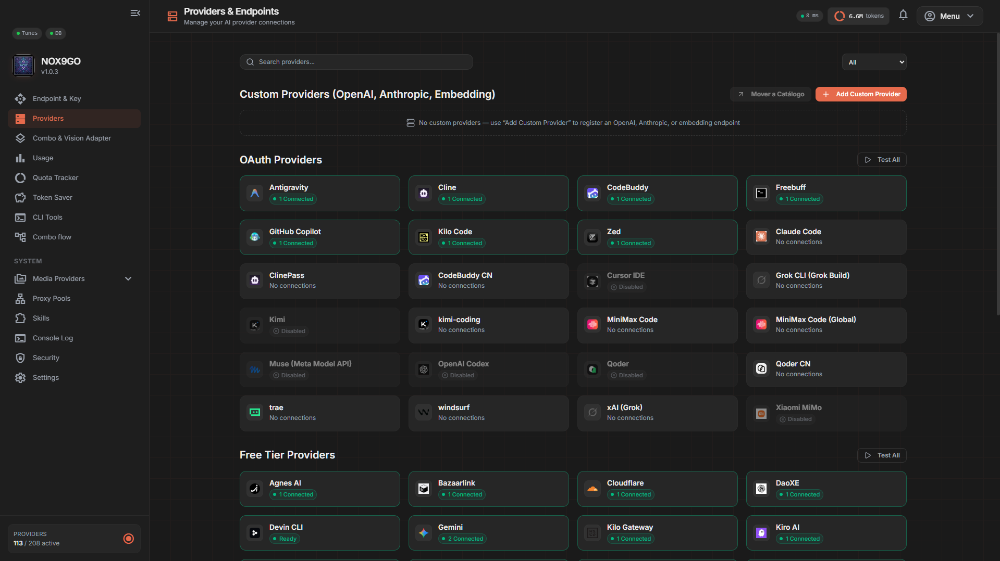
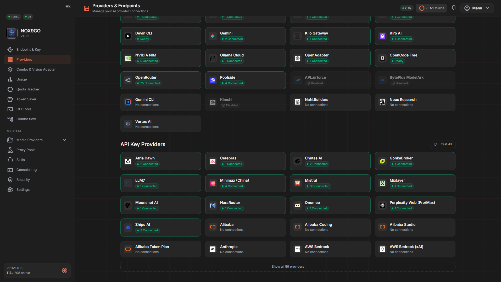
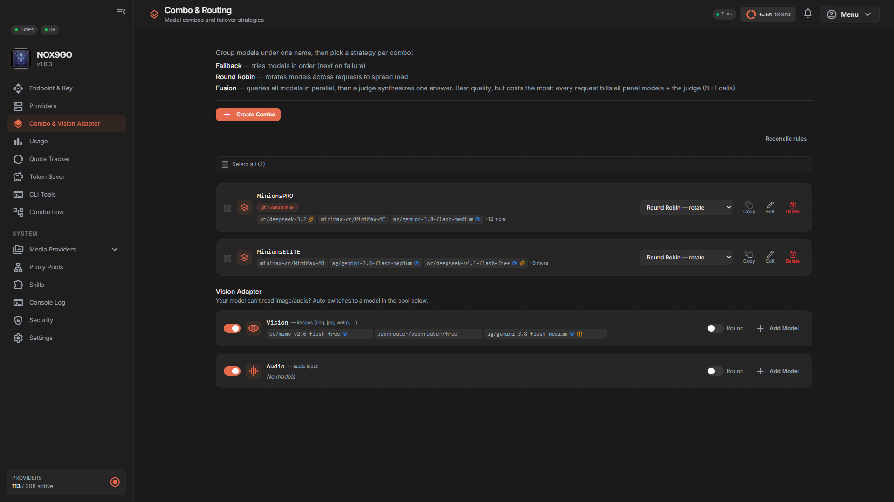
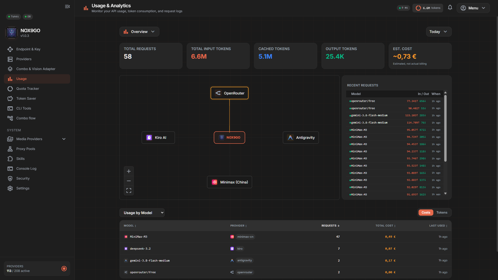
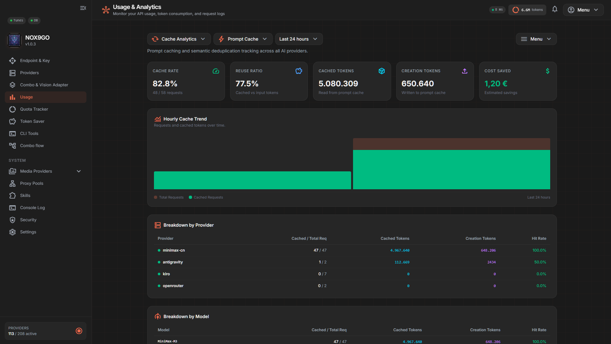
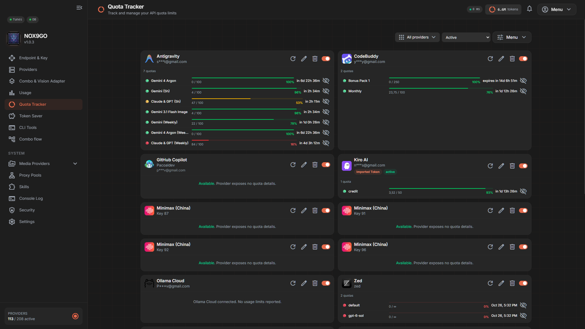
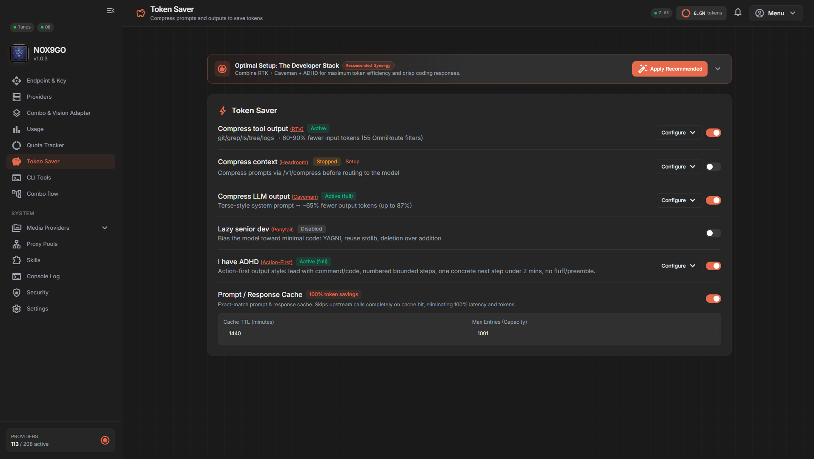
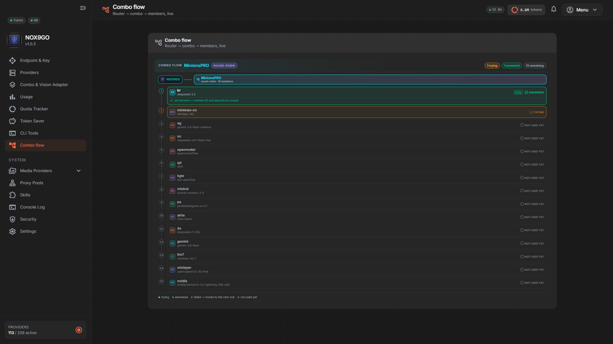
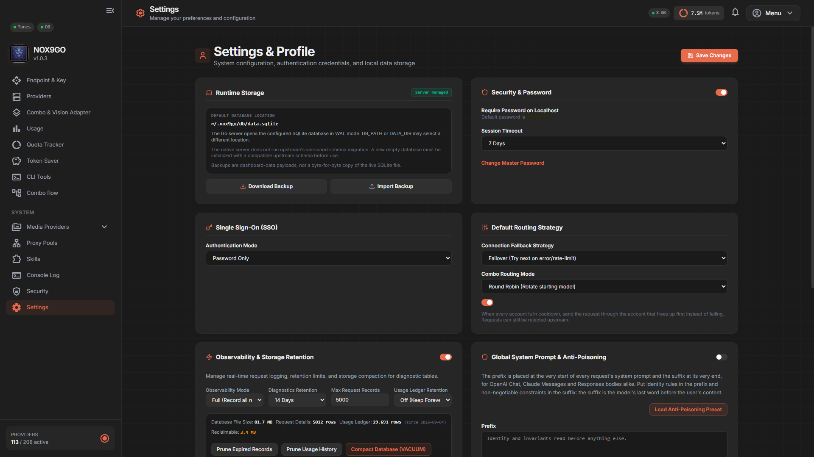

<div align="center">


# NOX9GO

### Un gateway de IA ligero, escrito en Go, para no interrumpir tu flujo de desarrollo

[](https://go.dev)
[](https://svelte.dev)
[](#instalacion)
[](#proveedores)
[](LICENSE)
[![Gentle-ai](https://img.shields.io/github/v/release/Gentleman-Programming/gentle-ai?label=Gentle-ai&logo=data:image/png;base64,iVBORw0KGgoAAAANSUhEUgAAABUAAAAcCAYAAACOGPReAAAAAXNSR0IArs4c6QAAAARnQU1BAACxjwv8YQUAAAAJcEhZcwAADsMAAA7DAcdvqGQAAAWkSURBVEhLrZZZbFRVGMdPZ%2bnc2Zc7M%2ffOnZk7d6Z3OvveTmfrTGcYu1uKZbO0BUGBQqAsCmjBIWGLYi1GEWvdCImJIBhfjEtMNCaaGHnixWjE6JM%2b%2bWBMFAJ%2fMyUQOxKB4C85L%2bd83%2b%2bck%2fOdk0PIHdhBeE9j330xTWfHT7dP%2fDEbXf7VifCyZ18ODaw%2b1lJI1cfeJC7DckKUjTn%2fyTF9tvJqx8RffYkudHvTWOnNY6UjjkkhfXVrtPvrA20jv8z4ll4cJ1q6Mfe2zBjSsZOxkW8fTnWj4ghjM5%2fHXrYT2%2bk0xrh2xFkRLk7AxtQgTniH3mnM%2fxcnPAPH93mr10ejJbisTkz6KqgyQexmO7HbmMMWaxbb2Ry2cnnEGC8OxYbxvFC98IQ%2bkmx0kVUKRph1979xJDsKD%2btCVozCYbSijwuhohEwZo5jkzGJrYYUHqDceNrTgyLtxWhLFntCAzjhHTzb6CQzzuq5t3IbkIqloVCqEGfccGhpDNM%2bRCkbtrJ5TNlLmOAyWEvH0af1YJiJoGhtRUgM42h06S8zuqBpkfQZS3Hv4%2fFBxKIpUM0UVFI5sjoeEYrBiK0NAR2PhNqJoJbDkDmCMWsc65xtUMop%2bHxhbPZXcJqtBhZJzzt623e0VtCezMKsM0FKCCJqDnaVBYKGQdkgYhUdwR62iEl7ARssSTBEDplKhUowgwO%2bnktfOjKLS2yi2dM36ey41hloQ8QfhZJIYNAawautECkzMgY3EowXAYcXdsYJs1wLLZEg6PRhOtKP%2fVx2tu6pESJZENZKJdlj%2blD5IJeb3tmS%2f7UvWUDCE4JaTkEtVYCVamCgLWgRvBAFL8y0FZRUjoiRR587CZfahC2O7JV5ayG6aKX72Y5ATR0NX%2fAvoV9K9qxbH82h1x1HXs9DLVOAolSwGC0w6IywKLQoqF2Iax1QEAkcFideT47jRWd1aqMmZSZzqZT8LFkhrYtBSNPNSQ6L6e8DMg2CejvKrB8Zk2th5YomGVopCwwSBZQSGTgzt1BSp3xLz%2byxpx276PY15OyKG8KbPK4KspOEN77b8VD%2fc94iBKkK9fmclB55nRO6Jjn0pBkcZUDY6sEGdwHHxd73HiRq5pakps5aa7Z84foL3yk%2bahsLn%2fEODbztHhpAsNZ8bsmartdCfReHTAKUEiksEgqCVIOC3o7ljtDlTXz6s5fE%2fqM1YlNtMyTGn6Bz2gXpU6aMfY%2b7NNfrjv9Y4PzXylY%2fRrgE1tgSl44GHuj4MDlUnrQGzmX1tt8tEgViFP3D8UBp%2fNP4SO50sMr%2fY5NkShvxTZmS6251pGziN1YtDQ9lgV1Bg1PS6KV9OOjtWlsfTxgtR4IS3ZWTzR2Bfl3r3qOu4qvzHcMLxf6ku9i5yxRfsVOXMdXbLekjocwEp7egpHZj0tQOu0QDTZMCJT3%2f57lAb%2bLRWHtcoDSX12rEDW%2f7VnP1nL2%2b8voeT%2bzrZY7EJ%2fssCRHArYNe4KfRfcYqG%2fjdJNOCk%2brQ1mRFlXDgJTos0fEHAEhjZu5qxeZaRgiRZM3Cx1vsnSiZWrGKCXXts7Z5thFRsUha5ylH6ZUs7YFfxUIvVYNv0qCTMIg26c98MbiRLztbLtXj5loePFVWecBI9cgZXb%2f%2btnTK0OhaxGxqoGu1kJjPOcTzOcZ9fKVO2L9bET4yHcgWh13%2b90FKsnWa0PW4nEWXTsQk2zaPUk3WWJp3ZD7cG32I93%2bwjPEdfNggljoU5kvdVvHzaU%2f55JuuHqEx%2fq7A3Jw8Z%2bGvlaXMqcO2TPL6zi%2bVl4VRV2PcPXEkUYlGtczPgxJ20wVSDJwleb5GYvEVJNjcGHvXdOtcF9MS02ftxNgzTRIu8XanfC%2fk5MyheJPx%2fHYiDq4nvhvX8H4Y07e6K0pu8zHi%2fX9%2bKfVncEzR6l5PWBdI7cZrfpf8DeRY4wJrYaUrAAAAAElFTkSuQmCC)](https://github.com/Gentleman-Programming/gentle-ai)

**NOX9GO** expone un único endpoint compatible con OpenAI y Anthropic para que tus herramientas de código puedan usar múltiples proveedores de IA, cuotas, claves y modelos sin cambiar de configuración.

Incluye compresión de contexto, failover automático, panel embebido, seguimiento de cuotas y uso (no en todos los proveedores), y soporte para texto, imágenes, voz, embeddings y búsqueda web.

[Empezar](#empezar) · [Arquitectura](#arquitectura) · [Proveedores](#proveedores) · [Funciones](#funciones) · [CLI](#cli) · [Preguntas](#preguntas-frecuentes)

</div>

---

## Sobre este fork

NOX9GO es un fork de [9Router](https://github.com/decolua/9router), reescrito en Go como binario autónomo.

Mantiene compatibilidad con el formato de API y la base de datos SQLite del proyecto original, pero elimina la dependencia de Node.js en ejecución y añade un panel Svelte 5 embebido, observabilidad ampliada, más estrategias de enrutado y empaquetado multiplataforma.

> Repositorio público. Las releases se publican como tags en GitHub.

---

## Empezar

### Requisitos

- Go 1.27
- Bun 1.x, solo para compilar el dashboard
- Un puerto libre, por defecto `20130`

### Compilar y arrancar

```bash
git clone https://github.com/Pacoaldev/Nox9Go.git
cd Nox9Go

make web-build
make build

./nox9go start
```

Abre el panel:

```text
http://localhost:20130
```

La contraseña inicial es:

```text
123456
```

### Conectar una herramienta

Configura tu CLI o IDE para usar el endpoint local:

```text
Base URL: http://localhost:20130/v1
API Key:  La que generes en Dashboard → API Keys
```

Ejemplo para Claude Code:

```bash
export ANTHROPIC_BASE_URL="http://localhost:20130"
export ANTHROPIC_API_KEY="<tu-api-key>"
```

Ejemplo para Cursor:

```text
Override OpenAI Base URL: http://localhost:20130/v1
OpenAI API Key: <tu-api-key>
```

---

## Arquitectura

NOX9GO actúa como una capa intermedia entre tus herramientas de desarrollo y los proveedores de IA.

```text
┌────────────────────────────┐
│  Claude Code · Codex       │
│  Cursor · Cline · OpenCode │
└─────────────┬──────────────┘
              │
              ▼
┌──────────────────────────────────────────┐
│                NOX9GO                    │
│                                          │
│  • Endpoint unificado                    │
│  • Traducción de formatos                │
│  • Compresión RTK                        │
│  • Enrutado por combos                   │
│  • Control de cuotas y failover          │
│  • Panel y métricas embebidos            │
└─────────────┬────────────────────────────┘
              │
              ▼
┌──────────────────────────────────────────┐
│  Proveedores de IA                       │
│  Suscripciones · APIs · modelos gratis   │
└──────────────────────────────────────────┘
```

En lugar de apuntar cada herramienta a un proveedor distinto, todas apuntan a NOX9GO. El gateway decide a qué modelo o proveedor enviar cada petición según disponibilidad, cuota, coste y estrategia configurada.

---

## Funciones

### Ahorro de contexto

| Función | Descripción |
|---|---|
| **RTK** | Comprime salidas de herramientas como `git diff`, `grep`, `ls` o `tree` antes de enviarlas al modelo. Activado por defecto. |
| **Caveman** | Reduce la verbosidad de las respuestas conservando el contenido técnico. |
| **Ponytail** | Favorece código mínimo, directo y orientado a YAGNI. |
| **ADHD** | Prioriza respuestas orientadas a la siguiente acción. |
| **Injection guard** | Detecta intentos de prompt injection en la salida de herramientas. Activado por defecto. |

RTK está pensado para reducir el consumo de tokens en contextos con mucha salida de terminal, sin romper la petición si un filtro falla.

### Enrutado inteligente

Los **combos** agrupan varios modelos o proveedores bajo un mismo nombre.

| Estrategia | Comportamiento |
|---|---|
| `fallback` | Prueba los modelos en orden hasta que uno responde |
| `round-robin` | Reparte las peticiones entre los modelos del combo |
| `sticky` | Mantiene temporalmente un cliente en el mismo modelo |
| `capacity` | Elige la entrada con más capacidad disponible |
| `fusion` | Combina respuestas de varias entradas |

También puedes rotar varias cuentas del mismo proveedor y asociar pools de proxy a una conexión concreta o a varias a la vez.

### Observabilidad

- Registro en vivo por SSE con filtros por nivel y búsqueda.
- Inspector de peticiones y respuestas.
- Métricas de tokens, coste estimado, caché y compresión.
- Análisis por modelo, proveedor y periodo personalizado.
- Detección de peticiones bloqueadas o lentas.

### Más allá del chat

El mismo gateway puede enrutar:

- Generación de imágenes
- Vídeo
- Texto a voz
- Voz a texto
- Embeddings
- Búsqueda web
- Lectura de páginas

---

## Screenshots

<details>
<summary>Galería con las principales vistas del panel y la CLI (11 capturas)</summary>

<table>
  <tr>
    <td align="center"><b>1 · Endpoint & API Key</b><br></td>
    <td align="center"><b>2 · Proveedores (1/2)</b><br></td>
  </tr>
  <tr>
    <td align="center"><b>3 · Proveedores (2/2)</b><br></td>
    <td align="center"><b>4 · Combos</b><br></td>
  </tr>
  <tr>
    <td align="center"><b>5 · Uso (1/2)</b><br></td>
    <td align="center"><b>6 · Uso (2/2)</b><br></td>
  </tr>
  <tr>
    <td align="center"><b>7 · Seguimiento de cuotas</b><br></td>
    <td align="center"><b>8 · Ahorro de tokens</b><br></td>
  </tr>
  <tr>
    <td align="center"><b>9 · CLI & IDE</b><br></td>
    <td align="center"><b>10 · Combo Flow</b><br></td>
  </tr>
  <tr>
    <td align="center" colspan="2"><b>11 · Ajustes</b><br></td>
  </tr>
</table>

</details>

## Proveedores

NOX9GO incluye un catálogo de 142 proveedores registrados y permite añadir endpoints compatibles con OpenAI o Anthropic desde el panel. "Registrado" significa que el proveedor está en el catálogo con su endpoint, su método de autenticación y sus modelos; no que cada integración esté verificada contra el servicio en cada release. Los catálogos de modelos cambian más rápido de lo que se puede revisar, así que un proveedor puede dejar de responder aunque siga listado.

### Suscripciones y OAuth

Algunos de estos servicios exigen credenciales de cliente OAuth propias: si es el caso, el panel lo indica al conectar la cuenta y `.env.example` muestra las variables que acepta.

| Prefijo | Proveedor |
|---|---|
| `cc` | Claude Code |
| `cx` | OpenAI Codex |
| `gh` | GitHub Copilot |
| `cu` | Cursor IDE |
| `ag` | Antigravity |
| `cl` | Cline |
| `xai` | xAI / Grok |
| `kimi` | Kimi |
| `windsurf` | Windsurf |
| `trae` | Trae |

### Opciones gratuitas

| Prefijo | Proveedor | Nota |
|---|---|---|
| `oc` | OpenCode Free | Sin autenticación |
| `kr` | Kiro AI | Cuota gratuita mensual limitada; el importe exacto lo fija el proveedor |
| `gc` | Gemini CLI | Nivel gratuito mediante OAuth |
| `mmf` | MiMo Code Free | Pool gratuito de código |
| `devin-cli` | Devin CLI | Permite usar parte de una suscripción existente |

### APIs y autoalojados

Entre otros: OpenAI, Anthropic, DeepSeek, Groq, Mistral, Together AI, Fireworks, Cerebras, OpenRouter, Azure OpenAI, AWS Bedrock, Vertex AI, Ollama local, Ollama Cloud, ComfyUI, SD Web UI y proveedores de búsqueda como Brave, Tavily, Exa, Serper o Firecrawl.

Los identificadores de modelo usan el formato:

```text
<prefijo>/<modelo>
```

Por ejemplo:

```text
kr/claude-sonnet-4.5
oc/gpt-5
glm/glm-4.6
```

---

## CLI

| Comando | Descripción |
|---|---|
| `nox9go` | Arranca el gateway en primer plano |
| `nox9go start` | Arranca en segundo plano |
| `nox9go stop` | Detiene el proceso en segundo plano |
| `nox9go restart` | Reinicia el gateway |
| `nox9go status` | Muestra estado, PID, panel y logs |
| `nox9go logs -n 100` | Muestra las últimas 100 líneas de log |
| `nox9go service install` | Registra el arranque automático |
| `nox9go service status` | Consulta el servicio registrado |
| `nox9go service uninstall` | Elimina el arranque automático |
| `nox9go version` | Muestra versión, sistema y arquitectura |
| `nox9go mitm enable` | Activa los comandos de proxy MITM |

### Arranque automático

```bash
nox9go service install
nox9go service start
nox9go service status
```

El comando detecta el mecanismo nativo disponible:

- systemd
- launchd
- OpenRC
- runit
- cron
- Tarea programada de Windows

---

## Configuración

La configuración en ejecución se realiza mediante variables de entorno.

| Variable | Valor por defecto | Descripción |
|---|---|---|
| `PORT` | `20130` | Puerto HTTP del gateway |
| `HOST` | Localhost | Interfaz de escucha |
| `DATA_DIR` | `~/.nox9go` | Directorio de datos |
| `DB_PATH` | `DATA_DIR/db/data.sqlite` | Ruta de la base SQLite |
| `RTK_ENABLED` | `true` | Activa o desactiva RTK |
| `CAVEMAN_ENABLED` | `false` | Activa el estilo Caveman |
| `PONYTAIL_ENABLED` | `false` | Activa el estilo Ponytail |
| `ADHD_ENABLED` | `false` | Activa el estilo ADHD |
| `INJECTION_GUARD_DISABLED` | `false` | Desactiva la protección contra prompt injection |
| `AUTO_UPDATE` | `false` | Permite actualizaciones automáticas |

---

## Base de datos compartida

NOX9GO puede usar el mismo directorio de datos que 9Router.

```bash
export DATA_DIR="/ruta/compartida/con/9router"
./nox9go start
```

Al apuntar ambos proyectos al mismo `DATA_DIR`, comparten:

- Proveedores
- Conexiones
- API keys
- Combos
- Historial de uso

No requiere importación. Comparte la base sin migrarla, así que antes de apuntar aquí una instalación existente haz una copia de la base de datos (`9router.db`; en una instalación de NOX9GO, `nox9go.db`) y de la configuración, y ten en cuenta que ambas versiones deben usar un esquema compatible: un 9Router más reciente puede haber añadido columnas que esta versión no conoce, y al revés. Si el esquema no coincide, vuelve a la copia.

---

## Compilación cruzada

Puedes generar binarios estáticos para varias plataformas:

```bash
make cross
```

Objetivos disponibles:

| Sistema | Arquitectura |
|---|---|
| Linux | amd64 |
| Linux | arm64 |
| macOS | amd64 |
| macOS | arm64 |
| Windows | amd64 |

La compilación usa `CGO_ENABLED=0`, por lo que el resultado es un binario autónomo sin dependencias externas.

---

## Dos ejecutables

El proyecto publica dos binarios con funciones distintas:

| Binario | Qué hace | Dónde |
|---|---|---|
| `nox9go` | El gateway: el servidor compatible con OpenAI y Anthropic, la CLI y el panel embebido. Es el que se ejecuta en todas las plataformas. | Linux, macOS, Windows |
| `nox9go-tray` | Un icono en la bandeja del sistema de Windows que arranca y para el gateway, y abre el panel. No sirve peticiones por sí mismo: habla con `nox9go`. | Solo Windows |

`make build` produce el primero y `make tray` el segundo. En Windows puedes usar `scripts/start-nox9go.ps1` para arrancar gateway y bandeja juntos y abrir el panel; en Linux y macOS no hay bandeja y el gateway se gestiona con `nox9go start` / `status` / `stop` o con `nox9go service install`.

---

## Preguntas frecuentes

### ¿NOX9GO cobra algo?

No. Es software que ejecutas en tu propia máquina. Los posibles costes dependen exclusivamente de los proveedores que configures.

### ¿El coste mostrado en el panel es una factura?

No. El panel calcula un coste estimado equivalente al uso de APIs de pago. Sirve para comparar ahorro, no para facturar.

### ¿RTK altera la respuesta del modelo?

RTK comprime la salida de herramientas antes de enviarla al modelo. Si el filtro falla o el resultado sería mayor que el original, se conserva el texto sin modificar.

### ¿Puedo usarlo sin pagar nada?

Sí. Puedes configurar proveedores gratuitos como OpenCode Free, Kiro AI o Gemini CLI y crear un combo con failover entre ellos.

### ¿Necesito Node.js para ejecutarlo?

No. Node.js y Bun solo son necesarios para compilar el dashboard desde el código fuente. El binario final es autónomo.

---

## Cómo accede a los proveedores (léelo antes de usar los proveedores "web")

NOX9GO habla con cada proveedor por su API oficial siempre que exista una. Pero algunos de los proveedores que ofrece funcionan de otra forma, y conviene saberlo antes de conectarlos y no descubrirlo después:

- **Reutiliza sesiones de navegador.** Para los proveedores que no tienen API pública (por ejemplo `perplexity-web`, `deepseek-web`, `gemini-web`), el gateway puede leer la cookie de sesión de Chrome o Firefox en tu equipo para enviar las peticiones como lo haría el navegador. Eso significa que el proceso puede leer y descifrar el almacén de cookies de tu perfil.
- **Imita al cliente oficial.** En varios de estos casos el gateway se presenta ante el servicio con la identidad y la huella de red del cliente o CLI oficial (cabeceras de versión, huella TLS, marcas específicas de cada servicio). Es intencionado: es lo que hace que el servicio acepte la petición.
- **Esto puede incumplir los términos del servicio.** Muchos proveedores prohíben expresamente el acceso automatizado fuera de su API, o hacerlo con un cliente que no es el suyo. Usado contra un servicio de pago sin autorización, puede además contravenir normas sobre acceso no autorizado en tu jurisdicción.

Por eso:

- Úsalo con **tu propia cuenta**, en un equipo del que eres responsable.
- No lo uses para revender acceso, para compartir una cuenta de suscripción con terceros ni para eludir un límite de plan.
- Los proveedores con API oficial no tienen ninguna de estas características y son la opción recomendada para cualquier uso que no sea personal.
- Esta sección no es una autorización ni un consejo legal: cada usuario decide qué conecta y asume las consecuencias, como se detalla en el aviso legal de abajo.

---

## Aviso legal / Disclaimer

NOX9GO es un proyecto de software experimental desarrollado para fines de **investigación, interoperabilidad técnica y uso personal privado**.

- El software se proporciona "tal cual" (*as-is*), bajo licencia MIT, sin garantías explícitas ni implícitas de disponibilidad, rendimiento o idoneidad para un fin específico.
- Cada usuario u operador es el único responsable de asegurar que el uso del software cumpla con los Términos y Condiciones de Servicio (ToS), políticas de uso aceptable y límites contractuales de las APIs y proveedores de terceros con los que decida conectarse.
- Los desarrolladores y colaboradores de NOX9GO no asumen ninguna responsabilidad por el mal uso, suspensión de cuentas, cargos de facturación o cualquier otra consecuencia derivada del uso de servicios de terceros a través de este gateway.

---

## Enlaces

- Proyecto original: [9Router](https://github.com/decolua/9router)
- Autor del fork: [Pacoaldev](https://github.com/Pacoaldev)
- Panel local: <http://localhost:20130>

<div align="center">

**NOX9GO** · Un gateway, muchas rutas, menos interrupciones.

</div>

---

<p align="center">
  <a href="https://github.com/Gentleman-Programming/gentle-ai">
    
  </a>
</p>
